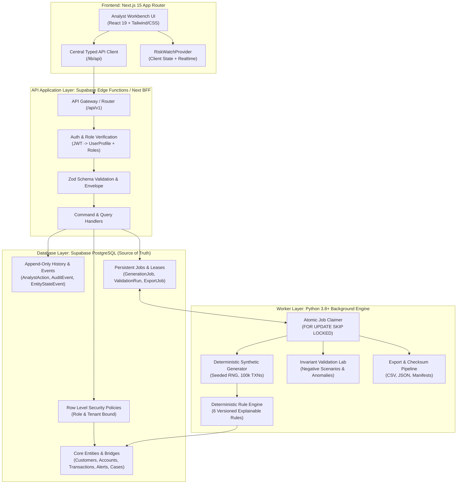
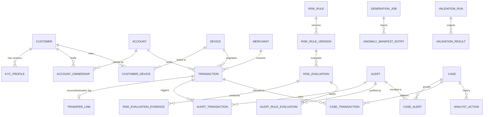

# RiskWatch System Architecture Specification

## 1. Executive Summary & Mission

RiskWatch is an enterprise-grade financial-risk intelligence platform and analyst workbench designed to monitor high-volume transaction activity, evaluate transparent version-controlled risk rules, generate explainable evidence-linked alerts, and coordinate collaborative investigations and dispositions with an append-only audit trail.

Synthetic datasets are used to benchmark detection algorithms and validate data pipelines deterministically without compromising confidential personal or financial records.

---

## 2. Core Entities and Domain Relationships

### Deterministic Business Identifier Formats
- Customers: `CUS-000001`
- Accounts: `ACC-<customer-id>-01` (e.g., `ACC-CUS-000001-01`)
- Transactions: `TXN-2026-00000001`
- Alerts: `ALT-2026-000001`
- Cases: `CASE-2026-000001`
- Rules: `RULE-VEL-01`, `RULE-DEV-01`, `RULE-CYC-01`, `RULE-DOR-01`, `RULE-LRG-01`, `RULE-MER-01`

---

## 3. Feature-to-File and Feature-to-Table/API Map

| Feature Area | Authoritative Database Tables | API Endpoints (`/api/v1/`) | Frontend Feature Files | Worker Domain Modules |
| :--- | :--- | :--- | :--- | :--- |
| **Auth & RBAC** | `user_profiles`, `user_roles` | `GET /me`, `POST /admin/roles` | `components/auth/`, `lib/auth/` | N/A |
| **Dashboard** | Aggregates of `transactions`, `alerts`, `cases` | `GET /dashboard/summary` | `app/app/overview/page.tsx` | N/A |
| **Customers & KYC** | `customers`, `kyc_profiles`, `account_ownership` | `GET /customers`, `GET /customers/:id` | `app/app/customers/` | `generators/master_data.py` |
| **Accounts & Balances**| `accounts`, `account_ownership` | `GET /accounts`, `GET /accounts/:id` | `app/app/accounts/` | `domain/account.py` |
| **Merchants & Devices**| `merchants`, `devices`, `customer_devices` | `GET /merchants`, `GET /devices` | Context panels & graphs | `generators/master_data.py` |
| **Transactions & Ledger**| `transactions`, `transfer_links` | `GET /transactions`, `POST /transactions` | `app/app/transactions/`, `app/app/transfers/` | `generators/transactions.py` |
| **Risk Rules & Engine**| `risk_rules`, `risk_rule_versions`, `risk_evaluations` | `GET /rules`, `POST /rules/:id/simulations` | `app/app/rules/`, `components/ui/RuleSimulator.tsx` | `risk_engine/` |
| **Alerts & Evidence** | `alerts`, `alert_transactions`, `alert_rule_evaluations` | `GET /alerts`, `GET /alerts/:id` | `app/app/alerts/` | `risk_engine/alerts.py` |
| **Cases & Dispositions**| `cases`, `case_alerts`, `case_transactions`, `analyst_actions` | `GET /cases`, `POST /cases/:id/disposition` | `app/app/cases/` | N/A |
| **Data Generation** | `generation_jobs`, `anomaly_manifest_entries` | `POST /jobs/generation`, `GET /jobs/:id` | `app/app/data-generator/` | `jobs/generation_job.py` |
| **Validation Lab** | `validation_runs`, `validation_results` | `POST /validation-runs`, `GET /validation-runs/:id` | `app/app/validation/` | `validation/` |
| **Ground Truth** | `ground_truth_labels` (isolated schema/table) | `GET /evaluation/metrics` (Admin/Reviewer) | `app/app/ground-truth/` | `evaluation/metrics.py` |
| **Exports & Manifests**| `export_jobs`, `dataset_manifests` | `POST /exports`, `GET /exports/:id` | `app/app/reports/` | `exports/` |
| **Audit & State Events**| `audit_events`, `entity_state_events` | `GET /audit-events` | `app/app/audit/` | `persistence/audit.py` |

---

## 4. Canonical Execution Paths

### 4.1 Read Path
1. Analyst changes filters or opens an alert queue.
2. Hook constructs typed parameters and invokes `api.alerts.list(params)`.
3. API Client validates parameters, binds active Clerk JWT bearer token, and issues request with `x-request-id`.
4. Endpoint verifies JWT, resolves `UserProfile` + `UserRole`, checks permission, and runs optimized parameterized SQL with RLS enforcement.
5. Database returns cursor-paginated rows using indexed composite keys.
6. API returns standardized `ApiSuccess<T>` envelope with `data` and `meta`.
7. UI updates cache and renders tabular data with active state indicators.

### 4.2 Synchronous Write Path (e.g., Case Disposition)
1. Analyst submits disposition form with disposition enum and required notes.
2. Form pre-validates against shared Zod schema.
3. API client POSTs payload with client idempotency key.
4. Server verifies actor role (`operations_analyst` or `risk_reviewer`).
5. Transactional PostgreSQL RPC executes:
   - Validates case existence and lock with `FOR UPDATE`.
   - Verifies case is open and disposition chronology (disposition time >= alert time).
   - Inserts immutable `analyst_actions` record.
   - Updates `cases` status and current disposition.
   - Appends `entity_state_events` and `audit_events` rows.
6. Database commits atomically; rollback occurs completely on any invariant breach.
7. Server responds with 200 OK + updated canonical Case DTO.

### 4.3 Background Job Execution Path (e.g., Synthetic Generation)
1. Admin triggers generation job (default seed `20261022`, 100k transactions).
2. API validates parameters, creates `generation_jobs` in `PENDING` state, and returns `202 Accepted` with `jobId`.
3. Python worker polls for available jobs using `SELECT ... FOR UPDATE SKIP LOCKED` and acquires a lease.
4. Worker executes pipeline stages:
   - Stage 1: Generate Master Data (5,000 customers, 7,000 accounts, merchants, devices).
   - Stage 2: Generate Transactions (100,000 transactions, reconciled balance ledger).
   - Stage 3: Generate Transfer Links (reconcile debit and credit legs).
   - Stage 4: Inject Controlled Anomaly Fixtures.
   - Stage 5: Evaluate 6 Risk Rules and persist evidence.
   - Stage 6: Generate Alerts and group into Cases.
   - Stage 7: Generate Ground Truth in isolated schema.
   - Stage 8: Run Validation suite and compute output checksums.
5. Worker updates durable checkpoints and row counts at each batch boundary.
6. Upon clean validation, worker writes manifests and transitions job to `SUCCEEDED`.
7. Frontend polling / Realtime channel updates job progress bar and unlocks data views.

---

## 5. Security and Role Permission Matrix

| Operation / Capability | `operations_analyst` | `risk_reviewer` | `system_admin` |
| :--- | :---: | :---: | :---: |
| View Dashboard & Filter Analytics | Read | Read | Read |
| View Customers, Accounts, Transactions | Read | Read | Read |
| Assign Cases / Add Case Notes | Create / Edit | Create / Edit | Create / Edit |
| Case Disposition (Approve / Escalate / Close) | Escalate / Note | Full Disposition | Full Disposition |
| Inspect Risk Rules & Evaluation Evidence | Read | Read | Read |
| Simulate Rule Drafts | Denied | Execute | Execute |
| Publish / Retire Risk Rule Versions | Denied | Denied | Execute (Audited) |
| Trigger Synthetic Dataset Generation | Denied | Denied | Execute (Audited) |
| Trigger Invariant Validation Run | Read Results | Execute | Execute |
| Request Data & Manifest Exports | Denied | Execute | Execute (Audited) |
| Inspect Full Audit Trail | Denied | Read (Scoped) | Full Search |
| Access Raw Ground Truth Labels | Denied | Read (Eval Only)| Read (Eval Only)|

